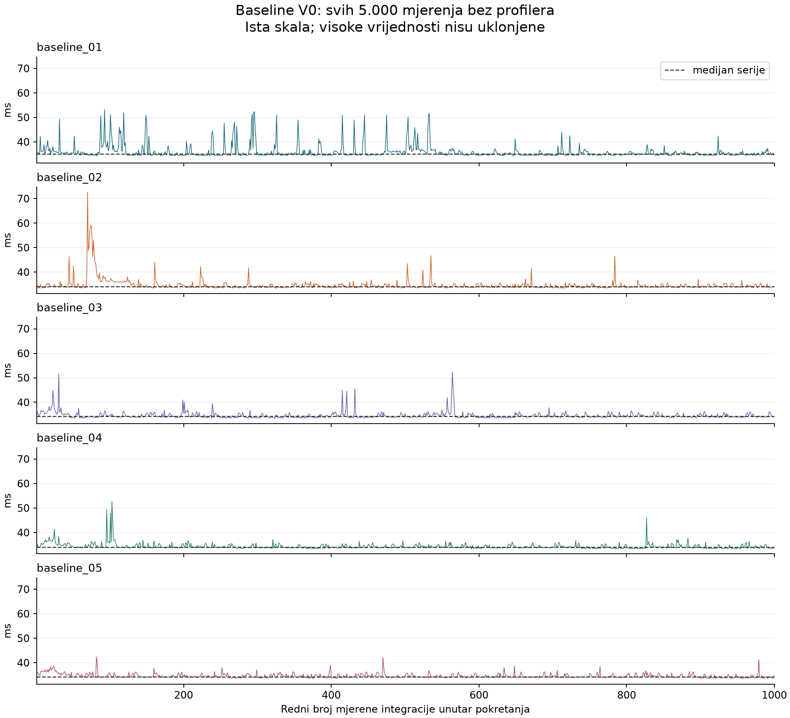
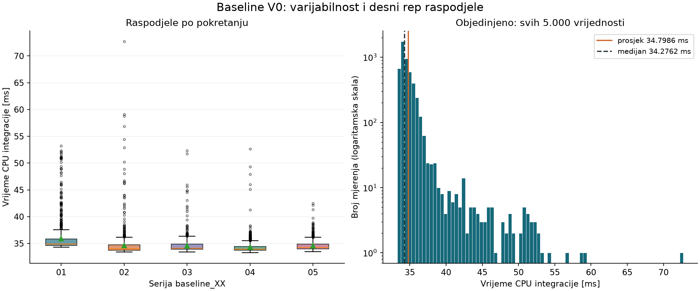
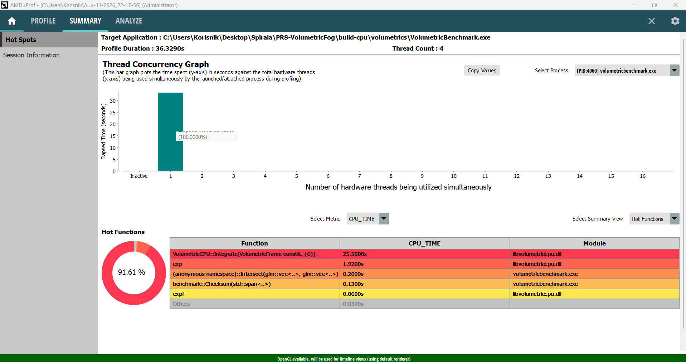
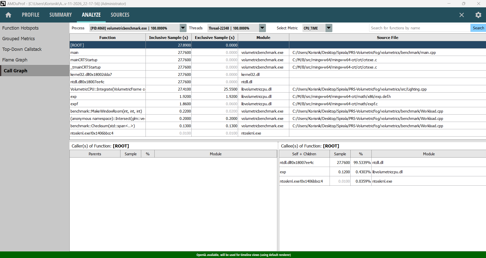
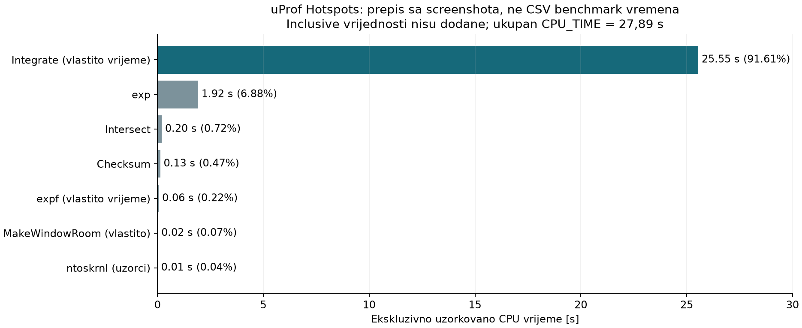
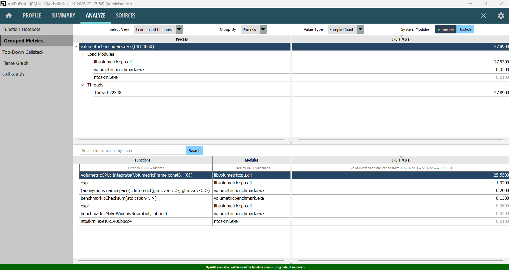
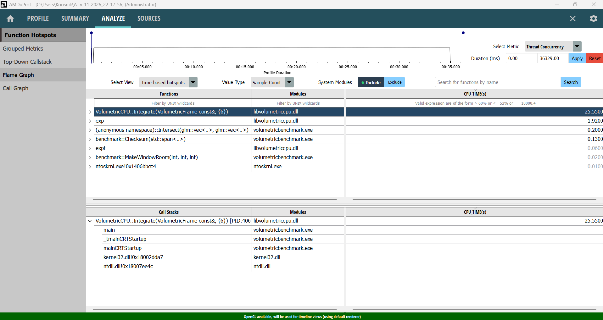
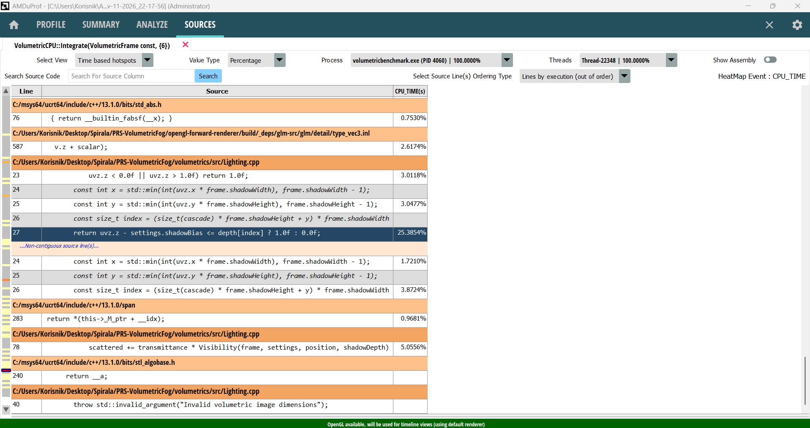
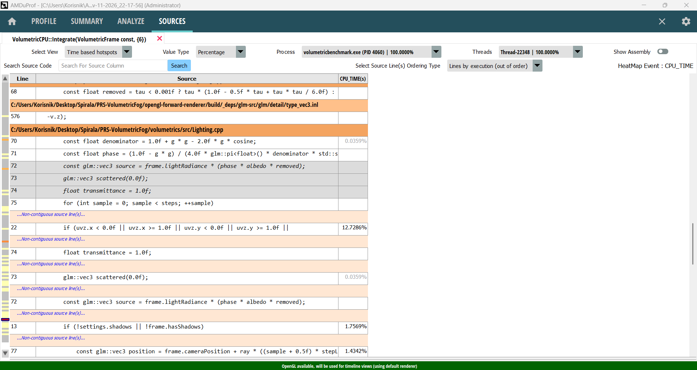
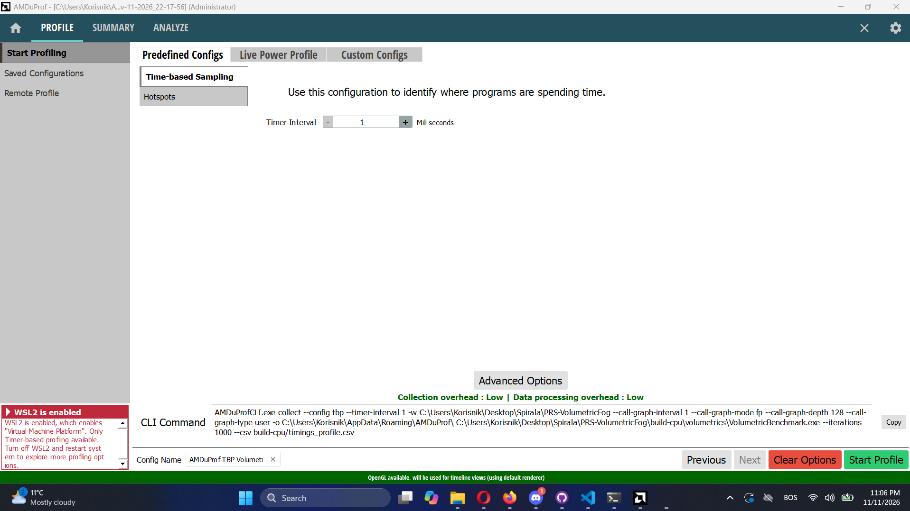

# Baseline V0 — sekvencijalni Volumetric Light and Fog

**Datum mjerenja: 11. 11. 2026. · CPU: AMD Ryzen 7 7730U · Status: početna sekvencijalna referenca**

Cilj je dokumentovati cijenu CPU integracije i područja koja treba istražiti
prije optimizacije i paralelizacije. Obrađeno je pet pokretanja bez profilera,
po 1.000 integracija, te AMD uProf Hotspots sesija s call-stack samplingom.
Tokom ove analize nisu pokretana nova mjerenja, mijenjani parametri, algoritmi,
kompajlerske opcije ili Windows postavke. Nisu uvedeni OpenMP, SIMD ni druge
optimizacije.

Objedinjeni medijan **5.000 originalnih mjerenja iznosi 34,27615 ms**, a prosjek
**34,79857 ms** po integraciji. Profil potvrđuje dominaciju CPU kernela i
značajnu atribuciju uzoraka kodu za provjeru vidljivosti svjetla. To određuje
prioritete istraživanja, ali ne dokazuje uzrok na nivou cachea ili grananja.

## 1. Izvori podataka i organizacija

```text
optimization/baseline/
  README.md
  results/
    baseline_01.csv ... baseline_05.csv  originalni podaci bez profilera
    statistics.csv                     izračunate statistike
    summary.json                       rezultati punom preciznošću
    summary-table.md                    reproduktivna Markdown tabela
    SHA256SUMS.txt                      hash vrijednosti pet CSV-ova
  screenshots/                         sedam originalnih PNG slika
  charts/                              tri izvedena grafikona
  profiler/timings_profile.csv          zaseban CSV profiliranog pokretanja
  metadata/
    session.uprof                      originalni metapodaci Hotspots sesije
    artifacts.json                     porijeklo i SHA-256 artefakata
    provenance.json                    revizija, hash izvora/binarnih fajlova i alati
    build-flags.txt                    zatečene opcije CPU DLL builda
  analyze_baseline.py
  requirements-analysis.txt
```

Pet CSV-ova pronađeno je u `build-cpu/`, a screenshotovi u korisnikovom folderu
`Pictures/Screenshots/`. Svih šest slika ranije poslanih u razgovoru pronađeno
je i vizuelno provjereno. Dodana je sedma slika s ograničenjem hardverskog
profiliranja. Kopije su **identične izvornim bajtovima**; originali nisu
prepravljani ni premješteni. Putanje, izvorna imena i hash vrijednosti nalaze
se u [manifestu artefakata](metadata/artifacts.json).

Originalne baze `cpu.db`, `callstack.db` i `session.db` ostaju u lokalnom folderu
`%APPDATA%/AMDuProf/AMDuProf-Hotspots-VolumetricBenchmark/AMDuProf-VolumetricBenchmark-Hotspots_Nov-11-2026_22-17-56/`.
Njihove putanje i hash vrijednosti su evidentirane; binarne baze nisu kopirane
u Git. [session.uprof](metadata/session.uprof) je arhiviran za provjeru
konfiguracije. Za ponovno otvaranje pune sesije sačuvati i navedene baze,
odgovarajuće binarne fajlove i simbole.

## 2. Okruženje i konfiguracija

| Stavka | Evidencija |
| --- | --- |
| Procesor | AMD Ryzen 7 7730U with Radeon Graphics |
| Logički procesori | 16 prema uProf metapodacima; kernel je sekvencijalan |
| Operativni sistem | Windows 11 Pro; sesija navodi `Win1125H2-64` |
| RAM prema sesiji | `totalRam: 15712 MB` — oznaka alata, ne memorijski promet |
| Zatečeni AMD uProf | 6.0.1520.0 prema instaliranom EXE-u; verzija formata sesije `12` nije verzija programa |
| Profil | `Hotspots`, metrika `CPU_TIME`, call-stack sampling uključen |
| Originalni timer interval | **10 ms**, potvrđeno u `session.uprof` |
| Call-stack konfiguracija | interval `1`, dubina `128`, opseg `user` prema originalnoj komandi |
| Sesija | 22:17:56–22:18:32, PID `4060`, dominantna nit `22348` |
| Kompajler / build | MSYS2 UCRT64 GCC 13.1.0, x64, C++20, CMake/MinGW Makefiles, Release |
| Opcije CPU DLL-a | `-O3 -DNDEBUG -g -fno-omit-frame-pointer`, bez LTO-a; vidi [build-flags.txt](metadata/build-flags.txt) |
| Revizija izvora | `ca93cdf9797ee30c0939a3114296acebd5cd1022`; radno stablo bilo čisto prije analize |
| Povezivanje | benchmark poziva `VolumetricCPU::Integrate` iz `libVolumetricCPU.dll` |

Revizija, hash relevantnog izvora i zatečenih EXE/DLL fajlova sačuvani su u
[provenance.json](metadata/provenance.json). Binarni hash nije zabilježen pri
pokretanju profilera: ovo je identifikacija fajlova zatečenih pri analizi, a ne
nezavisna historijska potvrda njihovog tadašnjeg hasha. Napajanje, power plan,
temperature, stvarni taktovi i pozadinsko opterećenje pet serija nisu evidentirani.

### Parametri potvrđeni u svih pet CSV-ova

| Parametar | Vrijednost |
| --- | --- |
| Mjerene iteracije | 1.000 po pokretanju, ukupno 5.000 |
| Interna rezolucija | 240 × 180, odnosno 43.200 piksela |
| Koraci po zraci | 64 |
| Sjene | uključene (`shadows=1`) |
| Shadow mape | četiri kaskade po 1024 × 1024 `float` vrijednosti |
| Gustoća | nominalno 0,04; zapis `0.039999999105930328` |
| Scattering albedo | nominalno 0,9; zapis `0.89999997615814209` |
| Anizotropija `g` | nominalno 0,2; zapis `0.20000000298023224` |
| Maksimalna udaljenost | 50 prostornih jedinica |
| Checksum svake integracije | `251039.45438732841` |

Dugi decimalni zapisi su postojeći `float` parametri ispisani visokom
preciznošću, a ne druga konfiguracija. Parametri su identični u svakom redu.

Workload `window-room-v1` je deterministička prostorija s tri otvora i
preprekama iz [Workload.cpp](../../volumetrics/benchmark/Workload.cpp). Prije
mjerenja generišu se scene depth i četiri shadow depth slike presjecima zraka
i kutija. To je geometrijski ulaz za isti rendererov CPU kernel; nije snimak
GPU CSM passa niti skup svih mogućih scena.

Kamera je na `(5.4, 2.8, 3.7)`, cilj `(-1.5, 2, -4)`, FOV 52°, clip ravni
0,1 i 60. Directional smjer je normalizovani `(0.45, -0.48, 1)`, radiansa
`(1, 0.86, 0.64) * 10`, a cascade splitovi `8, 18, 35, 60`.
Iz [postavki](../../volumetrics/include/volumetrics/Lighting.h) slijede bijela
magla, ambient intensity `0.12` i shadow bias `0.0005`; CLI ih ne mijenja.
To su podaci iz izvora, ne posebno izmjerene veličine.

CSV ne evidentira warmup. Default u [benchmarku](../../volumetrics/benchmark/main.cpp)
je tri integracije. Originalna uProf komanda ga ne mijenja, pa profilirano
pokretanje koristi taj default. Za pet neprofiliranih serija warmup nije
nezavisno potvrđen zapisom komande; nije pretpostavljen kao izmjeren podatak.

## 3. Metod obrade i vremena bez profilera

Provjereni su tačan CSV format, 1.000 redova po fajlu, indeksi `1..1000`,
konačna pozitivna vremena, konstantni parametri i identičan checksum. Nije
odbačena nijedna visoka vrijednost niti prva serija. Prema navodu autora,
pet serija izvršeno je bez uProf-a; CSV sam ne bilježi prisustvo drugog procesa.

Prosjek je aritmetički, SD uzoračka standardna devijacija s nazivnikom `N-1`,
a `CV = SD / prosjek * 100%`. Ukupni medijan računa se nad svih 5.000 vrijednosti,
ne nad pet medijana. Percentili koriste linearnu interpolaciju na `(N-1)*p`
(tip 7). Puna preciznost je u [summary.json](results/summary.json) i
[statistics.csv](results/statistics.csv).

| Serija | N | Prosjek [ms] | Medijan [ms] | Min [ms] | Max [ms] | SD [ms] | CV [%] |
| --- | ---: | ---: | ---: | ---: | ---: | ---: | ---: |
| `baseline_01` | 1000 | 35,91653 | 34,90990 | 34,29590 | 53,20860 | 2,85806 | 7,95751 |
| `baseline_02` | 1000 | 34,63106 | 33,96430 | 33,40230 | 72,72400 | 2,56024 | 7,39289 |
| `baseline_03` | 1000 | 34,58529 | 34,14340 | 33,43270 | 52,34310 | 1,45710 | 4,21306 |
| `baseline_04` | 1000 | 34,30173 | 33,94600 | 33,25570 | 52,65740 | 1,28974 | 3,75999 |
| `baseline_05` | 1000 | 34,55824 | 34,21655 | 33,48220 | 42,45970 | 0,92612 | 2,67990 |
| **Svih 5.000** | 5000 | 34,79857 | 34,27615 | 33,25570 | 72,72400 | 2,04843 | 5,88655 |

| Dodatna mjera, objedinjeni skup | Vrijednost |
| --- | ---: |
| 5. percentil | 33,609765 ms |
| Prvi kvartil | 33,898700 ms |
| Treći kvartil | 35,026775 ms |
| Interkvartilni raspon | 1,128075 ms |
| 95. percentil | 36,787915 ms |
| 99. percentil | 44,838225 ms |
| SD pet prosjeka pokretanja | 0,637964 ms |
| Raspon prosjeka, relativno prema najnižem | 4,70764% |
| Raspon medijana, relativno prema najnižem | 2,83951% |
| Broj vrijednosti iznad 40 ms | 113 / 5.000 (2,26%) |

Checksum podržava ponovljivost izlaza ovih pokretanja. Jedan skalarni checksum
ipak nije dokaz da su svi pikseli bit-identični niti zamjena za per-pixel
validaciju budućih optimizacija.

### Stabilnost i pouzdanost reference

Centralnih 90% vremena je približno 33,61–36,79 ms. Raspodjela ima desni rep:
prosjek je veći od medijana, a maksimum od 72,724 ms je iz druge serije.
Minimum nije reprezentativna zamjena za prosjek ili medijan.

Prva serija ima najveći prosjek i SD. Prosjek prve polovine te serije je
36,37161 ms, a druge 35,46145 ms; i druge serije imaju nešto niži prosjek
druge polovine. To pokazuje promjenu ponašanja, ali ne utvrđuje uzrok bez
informacija o taktovima, temperaturi i drugim procesima. Prva serija ostaje
u statistici. Medijan pet medijana je **34,14340 ms**, drugačiji od odabranog
objedinjenog medijana **34,27615 ms**.

V0 je upotrebljiva referenca za isti workload i protokol, uz vidljivu
varijabilnost. Pet pokretanja ne pretvara 5.000 uzastopnih integracija u
5.000 nezavisnih eksperimenata: isti podaci se ponovo koriste, a susjedna
vremena mogu biti korelisana. Zato nije izveden interval pouzdanosti koji
bi pretpostavljao nezavisnost svih redova. Poboljšanja reda nekoliko procenata
zahtijevaju nova uporediva pokretanja, a ne samo jedan brži rezultat.



Slika 1. Svih 1.000 intervala po pokretanju na istoj skali. Isprekidana linija
je medijan serije; visoke vrijednosti su sačuvane.



Slika 2. Boxplot: Q1–Q3, medijan, trougao za prosjek i tačke izvan 1,5 IQR
brkova. Sve tačke ostaju u statistici. Histogram koristi logaritamsku skalu
broja mjerenja radi vidljivosti desnog repa.

## 4. Benchmark intervali i uProf vrijeme nisu ista mjera

`std::chrono::steady_clock` obuhvata neposredno poziv `Integrate`: `kernel_ms`
je protekli interval koji može sadržavati uticaj raspoređivanja procesa.
Generisanje scene, alokacije, warmup, checksum i CSV ispis su izvan intervala.
Nema OpenGL readbacka/uploada ni rendererskog UI-a.

uProf vidi cijeli EXE, uključujući pripremu, warmup, checksum i runtime.
Hotspots je uzorkovanje. Inclusive vrijednost uključuje pozvane funkcije,
a exclusive vlastite uzorke funkcije. To nije instrumentirano mjerenje svakog
poziva ili C++ izraza. Vidi AMD-ovo objašnjenje
[time-based profiliranja](https://docs.amd.com/r/en-US/68658-uProf-getting-started-guide/Time-Based-Profiling)
i [principa uzorkovanja](https://docs.amd.com/r/en-US/57368-uProf-user-guide/Profiling-Concepts).

| Veličina profiliranog pokretanja | Vrijednost | Značenje |
| --- | ---: | --- |
| Profile Duration | 36,329 s | trajanje sesije u metapodacima/GUI-u |
| CPU_TIME / ROOT | 27,89 s | prikazano uzorkovano CPU vrijeme |
| Zbir `kernel_ms` profiliranog CSV-a | 34,226951 s | zbir 1.000 proteklih intervala poziva |
| Prosjek tog CSV-a | 34,226951 ms | zaseban dijagnostički podatak |

Mjere imaju različit obuhvat i metod. Ne sabiraju se; iz njihove razlike
ne izvodimo idle vrijeme, čekanje memorije ili tačan overhead profilera.
Nije rađen kontrolisan eksperiment overheada.
[Profilirani CSV](profiler/timings_profile.csv), završen u 22:18:31, sačuvan
je odvojeno i nije uključen u pet baseline serija.

## 5. Funkcije i call stack



Slika 3. Profil od 36,329 s, Thread Count 4 i najveći udio vlastitog vremena
u `Integrate`.



Slika 4. Call graph omogućava razdvajanje inclusive i exclusive podataka.

Tabela je provjeren prepis iste sesije. Exclusive procenti izvedeni su
dijeljenjem s 27,89 s.

| Funkcija | Inclusive [s] | Exclusive [s] | Exclusive udio |
| --- | ---: | ---: | ---: |
| `VolumetricCPU::Integrate` | 27,41 | 25,55 | 91,61% |
| `exp` | 1,92 | 1,92 | 6,88% |
| `expf` | 1,86 | 0,06 | 0,22% |
| `benchmark::MakeWindowRoom` | 0,22 | 0,02 | 0,07% |
| `Intersect` | 0,20 | 0,20 | 0,72% |
| `benchmark::Checksum` | 0,13 | 0,13 | 0,47% |
| evidentirani `ntoskrnl` uzorci | 0,01 | 0,01 | 0,04% |

`Integrate` inclusive je približno **98,28%** CPU_TIME-a. Ne dodavati mu
`exp` vrijeme, jer pozvane funkcije ulaze u inclusive vrijednost. Također
ne sabirati `expf` inclusive s `exp`, niti `MakeWindowRoom` inclusive s
njegovim `Intersect` dijelom. `main`, CRT i sistemski okviri s 27,76 s
inclusive nisu dodatni troškovi te veličine: sadrže pozvani benchmark.



Slika 5. Graf koristi samo exclusive vrijednosti iz tabele, bez dodavanja
inclusive vremena. Nije graf vremena pet neprofiliranih CSV serija.



Slika 6. CPU DLL ima 27,53 s, EXE 0,35 s i prikazani sistemski modul 0,01 s.
DLL nosi približno **98,71%** CPU uzoraka i uključuje pripisani matematički
runtime. Udio DLL-a nije nova stavka koju dodajemo njegovim funkcijama.



Slika 7. Dominantni kernel pozvan je iz benchmark `main` funkcije.

### Zašto dominira `Integrate`

U [Lighting.cpp](../../volumetrics/src/Lighting.cpp) vanjska petlja obrađuje
43.200 piksela. Za svaki validan piksel rekonstruiše svjetsku poziciju iz
dubine, formira zraku, određuje dužinu i priprema koeficijente raspršenja.
Unutrašnja petlja prolazi 64 midpoint uzorka, poziva `Visibility` i akumulira
svjetlost/transmitansu. Za validne zrake to je **2.764.800 uzoraka po
integraciji**, odnosno **2.764.800.000 za 1.000 mjerenih integracija**.
To je obim petlji izveden iz koda i parametara, ne izmjeren broj instrukcija;
warmup nije uključen u te brojeve.

Fixture se priprema jednom po procesu, a checksum nakon svake integracije.
Njihov mali udio potvrđuje da benchmark dominantno mjeri željeni CPU rad.
Checksum ipak čita izlaz i utiče na cache stanje između poziva, iako je
izvan mjerenog intervala. Taj protokol treba sačuvati u narednim poređenjima.

## 6. Izvorne linije i `Visibility`



Slika 8. Prikaz izvora uključuje inlinirane standardne i GLM operacije.



Slika 9. Nastavak iste sesije. Redoslijed je `Lines by execution (out of order)`;
ponovljene linije nisu novi nezavisni eksperimenti.

Brojevi linija odgovaraju navedenoj reviziji. Prikazani procenti su udjeli
`CPU_TIME` uzoraka, **ne broj izvršavanja operacije**. Nisu normalizovani na
36,329 s trajanja sesije. Granularnost od 0,0359% približno odgovara odnosu
0,01 s / 27,89 s i podržava osnovicu ukupnog CPU_TIME-a izabranog procesa/niti.
Ovo je provjera konzistentnosti prikaza, ne novo precizno mjerenje linije.

| Linija | Područje koda | Udio na slici | Oprezno tumačenje |
| --- | --- | ---: | --- |
| 27 | `uvz.z - shadowBias <= depth[index]` | 25,3854% | hotspot oko čitanja dubine i poređenja; nije mjerenje latencije čitanja |
| 22 | granice `uvz.x` i `uvz.y` | 12,7286% | značajna atribucija provjerama; ne dokazuje branch misprediction |
| 78 | `Visibility(...)` i `scattered` akumulacija | 5,0556% | kombinovan izraz, bez zasebne cijene svakog operatora |
| 26 | linearizacija shadow indeksa | 3,8724% | jedna vidljiva atribucija ponovljenoj liniji |
| 25 | Y koordinata texela | 3,0477% | mapiranje koordinate na cjelobrojni indeks |
| 23 | provjera `uvz.z` | 3,0118% | nastavak višelinijskog uslova iz linije 22 |
| 24 | X koordinata texela | 1,7210% | vrijednost u ponovljenom nekontinuiranom bloku |

Preliminarna očitanja iz zahtjeva su potvrđena. Tabela **nije zbir ukupne
cijene `Visibility` funkcije**. Optimizovani build, inlining, pomjeranje
instrukcija i mapiranje debug informacija utiču na red kojem su uzorci
pripisani. `Visibility` linije unutar `Integrate` prikaza konzistentne su
s inliningom; odsustvo zasebnog reda funkcije ne znači nultu cijenu.
Prazno polje također nije dokaz nule. Bez izvoza svih adresa/instrukcija
ne treba sabirati ponovljene redove kao nezavisne troškove.

Za svaki uzorak `Visibility` provjerava dostupnost sjena, računa view-space
dubinu i odabire kaskadu, transformiše položaj u prostor svjetla, radi
perspektivno dijeljenje i provjere granica, pa računa texel i čita dubinu.
Rani izlazi preskaču dio operacija: broj poziva nije nužno broj čitanja texela.

Shadow bafer zauzima `4 * 1024 * 1024 * sizeof(float)` = **16 MiB**.
Scene depth ima 168,75 KiB, a RGBA izlaz 675 KiB. To su veličine iz dimenzija
i tipova, ne mjereni memorijski promet. Scene depth i izlaz obrađuju se
redom, dok shadow indeks zavisi od transformisanog uzorka i kaskade.
Susjedni uzorci mogu koristiti iste/bliske texele; veličina bafera sama
ne određuje lokalnost.

Zbog ponavljanja, transformacije, memorijski pristupi i grananja zaslužuju
dalju analizu. **Nije dokazano da je kernel memory-bound**, niti da linija 27
čeka na cache promašaje. Atribucija može obuhvatiti povezane instrukcije
i zavisnosti; bez hardverskih podataka uzrok se ne može izdvojiti.

## 7. Matematičke operacije

Beer–Lambert koristi `stepT = exp(-density * stepLength)` (linija 66) i
`totalT = exp(-density * distance)` (linija 81). Oba izraza su **izvan
unutrašnje petlje**, po jednom za piksel koji stigne do njih: očekivano
86.400 evaluacija izvornog `std::exp` izraza po integraciji, a ne dva
eksponencijala po svakom od 64 koraka. Unutar koraka transmitansa se množi.

Henyey–Greenstein faza (linije 69–72) koristi ugao zrake prema svjetlu i `g`,
uz skalarni proizvod, korijen i dijeljenje. Faza i izvor su pripremljeni
jednom po pikselu. Rekonstrukcija zrake uključuje dužinu/korijen i
normalizaciju. Stabilna aproksimacija `1-exp(-tau)` za malu optičku dubinu
već je dio V0 i nije izmjena ove analize.

`exp` ima 1,92 s exclusive uzoraka, pa matematički runtime ima vidljiv udio.
`expf` ima 1,86 s inclusive, ali samo 0,06 s exclusive; inclusive vrijeme
ne dodajemo `exp` vremenu. Nazivi simbola sami ne dokazuju pogrešnu promociju
svih C++ izraza u `double`: argumenti u izvoru su `float`. Mala/prazna
atribucija uz HG red ne dokazuje da fazna funkcija ništa ne košta.

Naredna istraživanja mogu provjeriti runtime, broj potrebnih evaluacija i
numeričke zavisnosti. Promjena preciznosti, aproksimacije ili uklanjanje
eksponencijala zahtijeva provjeru greške i CPU/GPU podudaranja; ovdje nije urađena.

## 8. Sekvencijalno izvršavanje

Concurrency graf pokazuje jednu istovremeno aktivnu hardversku nit tokom
praktično cijelog vidljivog računanja. `Thread Count: 4` je broj evidentiranih
niti procesa, ne dokaz četiri radne niti kernela. Grupisani uzorci vezani
su za nit `22348`. Metapodaci ne navode posebno thread-concurrency tracing
prikupljanje; graf nije zamjena za tracing svakog raspoređivanja. Zajedno
s odsustvom paralelnih konstrukcija u izvoru, rezultat odgovara sekvencijalnom V0.

Maska dostupnih jezgri je `FFFF`: jedna aktivna nit ne znači trajnu vezanost
za jedno određeno jezgro. Graf ne dokazuje ni punu iskorištenost izvršnih
jedinica. Ovaj zapis daje referencu za kasniji OpenMP eksperiment.

Vanjska petlja po pikselima ima nezavisne izlaze, dok unutrašnja akumulacija
zavisi od prethodnih koraka. Raspodjela piksela je prirodno mjesto buduće
paralelizacije. Ubrzanje nije poznato unaprijed: zavisi od rasporeda, cachea,
memorijskog sistema i upravljanja nitima. Udio od 91,61% exclusive nije sam
po sebi precizno izmjeren paralelizabilni udio za Amdahlovu procjenu.

## 9. Ograničenja hardverskog profiliranja



Slika 10. **Kasniji prikaz u 23:06:02** s porukom `WSL2 is enabled` i TBP
timerom od 1 ms. Ovo nije originalna Hotspots konfiguracija od 10 ms i ne
mijenja metapodatke sesije iz 22:17:56.

Originalna sesija bilježi `hypervisorEnabled: true`, `Microsoft Hyper-V`,
bez PMC događaja i s isključenim IBS-om. Prema autoru, pokušano je privremeno
isključivanje Hyper-V-a/VBS-a, ali dodatne konfiguracije nisu postale dostupne.
Nema zapisa svih sistemskih promjena niti novog uspješnog hardverskog profila;
ne tvrdimo da su pokušaji uklonili sva ograničenja. U ovoj analizi sistem
nije rekonfigurisan.

AMD dokumentuje ograničenje Windows EBP/IBS-a uz Hyper-V u
[CPU profiling release notes](https://docs.amd.com/r/en-US/63856-uProf-release-notes/CPU-Profiling).
To daje kontekst poruci, ali nije nezavisna dijagnoza svakog problema na računaru.

| Metrika / analiza | V0 status |
| --- | --- |
| Vremena integracije bez profilera | izmjereno u pet CSV serija |
| Hotspots, call stacks i izvorne linije | uspješno prikupljeno |
| Aktivnost niti | dostupna prema grafu, uz navedena ograničenja |
| Cache misses / hit rate / cache-line promet | **nije direktno izmjereno** |
| Memorijska latencija / bandwidth / load stalls | **nije direktno izmjereno** |
| Instrukcije, cycles, IPC i CPI | **nije direktno izmjereno** |
| Branch misses / misprediction rate | **nije direktno izmjereno** |
| Taktovi i temperature baseline serija | nisu evidentirani |

Brojači se mogu naknadno pokušati prikupiti drugim podržanim alatom ili
u drugom okruženju. V0 ne sadrži izmišljene vrijednosti nedostupnih metrika.

## 10. Nalazi, indikacije i hipoteze

| Status | Zaključak | Granica zaključka |
| --- | --- | --- |
| **Izmjereno / provjereno** | iste konfiguracije/checksum, medijan 34,27615 ms, prosjek 34,79857 ms | važi za ovaj fixture i protokol |
| **Izmjereno / provjereno** | kernel dominira uzorcima: 25,55 s exclusive, 27,41 s inclusive | nije trajanje jednog poziva niti dokaz uzroka zastoja |
| **Izmjereno / provjereno** | velik udio atribucije shadow lookupu i provjerama | nije izolovana cijena jedne mašinske operacije |
| **Rezultati sugerišu** | prioritetno istražiti visibility/shadow dio i matematički runtime | potvrditi kontrolisanim eksperimentima |
| **Hipoteza** | shadow pristupi mogu ograničavati lokalnost | cache misses i latencija nisu izmjereni |
| **Hipoteza** | granice/kaskade mogu imati cijenu grananja i zavisnosti | branch misprediction nije izmjeren |
| **Hipoteza** | dio transformacija možda se može pripremiti po zraci | provjeriti preciznost, prelaze kaskada i stvarno ubrzanje |
| **Hipoteza** | stanje procesora/drugi procesi mogu uticati na varijaciju | nema odgovarajućih sistemskih mjerenja |

## 11. Naredni eksperimenti — bez implementacije u V0

1. **Kontrolisani protokol:** zabilježiti napajanje, power plan, binarne hash
   vrijednosti, warmup i okruženje; ponoviti više istih pokretanja i porediti
   statistike po pokretanju. Vremena mjeriti odvojeno od profilera.
2. **Visibility i transformacije:** istražiti pripremu dijelova transformacije
   po zraci, ponovljena računanja i redoslijed provjera. Sačuvati ponašanje
   na cascade splitovima i rubovima shadow mapa.
3. **Lokalnost:** provjeriti shadow pristupe i eventualnu grupnu obradu
   piksela. Ne uvoditi layout/tiling samo zbog procenta jedne linije; gdje
   je moguće, potvrditi nalaze brojačima.
4. **Matematički runtime:** provjeriti eksponencijale i korijene uz mjerenje
   numeričke greške svake promjene. `exp` je već izvan unutrašnje petlje.
5. **OpenMP po pikselima:** naknadno uporediti broj niti i rasporede uz
   mjerenje overheada i validaciju. Sačuvati zavisnosti akumulacije po zraci.
6. **SIMD/layout kao odvojena iteracija:** tek na osnovu nalaza istražiti
   vektorizaciju i raspored podataka, bez spajanja više nezavisnih izmjena
   u jedan neobjašnjiv rezultat.

Svaku verziju provjeriti na istim ulazima, uz per-pixel/analitičke provjere
i postojeće CPU/GPU testove. Ubrzanje računati istom statistikom iz vremena
bez profilera. Ovaj headless baseline predstavlja CPU kernel, ne end-to-end
FPS renderera: readback, upload, GPU pass i UI nisu mjereni interval.

## 12. Reprodukcija analize i zaključak

Iz korijena repozitorija, u Python okruženju s navedenim paketom:

```powershell
python -m pip install -r optimization/baseline/requirements-analysis.txt
python optimization/baseline/analyze_baseline.py
```

Skripta čita arhivirane CSV ulaze, provjerava konzistentnost i generiše
statistike/grafikone. Ne pokreće benchmark ili profiler, ne prepisuje originalne
CSV-ove/slike i ne mijenja CPU/GPU izvore. Statistika koristi standardnu Python
biblioteku. Tabela odjeljka 3 odgovara [summary-table.md](results/summary-table.md).
Graf funkcija koristi označen prepis exclusive vrijednosti sa screenshota,
ne simulirani ili novi profil.

Prije obrade skripta provjerava hash arhiviranih dokaza prema fiksnom manifestu;
ne zavisi od originalnih apsolutnih putanja. Pri izradi izvještaja prosjeci,
medijani, uzoračke SD vrijednosti i objedinjeni P95 nezavisno su provjereni
NumPy implementacijom. Provjereni su i podudaranje Markdown tabele s izvedenim
rezultatima, relativne putanje slika/linkova te nepromijenjeni CPU/GPU izvori.

**V0 dokumentuje medijalnu integraciju od približno 34,28 ms i prosjek
34,80 ms, uz vidljivu varijabilnost.** Dominira sekvencijalni kernel,
a shadow visibility je važan kandidat za istraživanje. Memorijski uzroci
i predikcija grananja ostaju hipoteze. Sačuvani podaci i ograničenja daju
provjerljivu referencu za buduća ubrzanja, bez prepravljanja početnog stanja.
