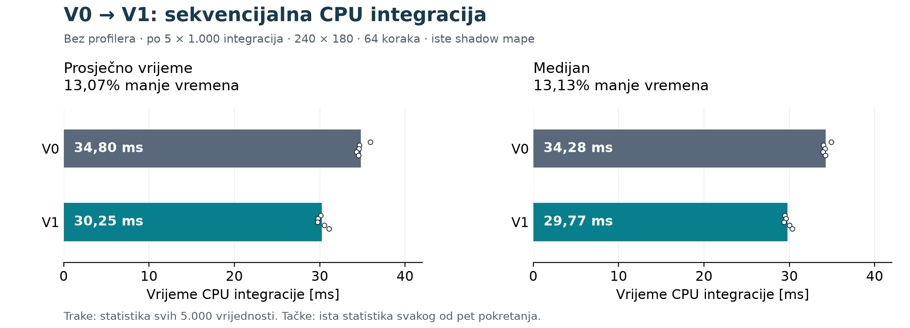

# V1 — prva sekvencijalna optimizacija

## 1. Problem u V0 i promjene u V1

[V0 analiza](../baseline/README.md) pokazala je značajan trošak provjere
vidljivosti, transformacija i shadow-map lookupa unutar ray-marching petlje.
V1 smanjuje ponovljeni rad, uz isti model i kvalitet:

- **Shadow podaci** i početak svakog kaskadnog sloja pripremaju se jednom po integraciji.
- **Afine transformacije** directional sjena koriste poznato `w=1`, bez nepotrebnog dijeljenja.
- **Odabrana kaskada** ponovo se koristi duž zrake, uz provjeru prelaza u oba smjera.
- **Pikseli** se obilaze po redovima, bez cjelobrojnog dijeljenja/modulo po pikselu.
- **Directional računanje** preskače se kada svjetlo nema doprinosa.

Tri kratka izvoda iz stvarnog [V1 koda](../../volumetrics/src/Lighting.cpp)
i V0 verzije tog fajla iz revizije `ca93cdf`:

**Pripremljeni slojevi:** V0 svaki put uračunava pomak kaskade; V1 koristi
unaprijed pripremljen pokazivač i jednostavniji indeks unutar sloja.

```cpp
// V0: Visibility
const size_t index = (size_t(cascade) * frame.shadowHeight + y) * frame.shadowWidth + x;
// V1: PrepareShadows, zatim Visibility
cascade.depth = depth.data() + i * layerSize;
const size_t index = size_t(y) * shadows.width + x;
```

**Afini put:** V1 računa samo potrebne komponente i izostavlja dijeljenje s
jedinicom. Za projektivne matrice ostaje opći put s perspektivnim dijeljenjem.

```cpp
// V0
const glm::vec4 clip = frame.shadowMatrices[cascade] * glm::vec4(position, 1.0f);
const glm::vec3 uvz = glm::vec3(clip) / clip.w * 0.5f + 0.5f;
// V1: afine matrice
const glm::vec3 clip = (c[0] * position.x + c[1] * position.y)
                     + (c[2] * position.z + c[3]);
uvz = clip * 0.5f + 0.5f;
```

**Ponovno korištenje kaskade:** umjesto početka od nule za svaki uzorak,
V1 u afinom putu nastavlja od prethodne kaskade iste zrake.

```cpp
// V0: pri svakom pozivu Visibility
int cascade = 0;
while (cascade < 4 && viewDepth > frame.shadowSplits[cascade]) ++cascade;
// V1: koristi prethodnu vrijednost cascade
while (cascade > 0 && viewDepth <= shadows.splits[cascade - 1]) --cascade;
while (cascade < 4 && viewDepth > shadows.splits[cascade]) ++cascade;
```

## 2. Izmjereno poređenje V0 i V1

Ponovo su obrađeni originalni [V0 CSV-ovi](../baseline/results/) i svih pet
[V1 CSV-ova](results/): **po 5 × 1.000 integracija bez profilera**, bez odbacivanja
vrijednosti. Prosjek i medijan računaju se nad svih 5.000 intervala svake verzije,
ne nad pet medijana.

Konfiguracija je ista: Ryzen 7 7730U, Windows 11, GCC 13.1 Release, `window-room-v1`,
**240 × 180 piksela, 64 koraka i četiri shadow mape 1024²**. Gustoća, albedo,
anizotropija i domet također su identični prema CSV kolonama.

| Mjera | V0 | V1 | Manje vremena | Faktor ubrzanja |
| --- | ---: | ---: | ---: | ---: |
| Prosjek integracije | 34,79857 ms | 30,25113 ms | **13,07%** | **1,150×** |
| Medijan integracije | 34,27615 ms | 29,77430 ms | **13,13%** | **1,151×** |
| Checksum svih redova | identičan | identičan V0 | — | — |

Checksum svih **10.000** redova je `251039.45438732841`.
Smanjenje je `(1 − V1/V0) × 100%`, a faktor ubrzanja `V0/V1`, odvojeno za svaku
statistiku. [Puna statistika](results/comparison.json) i
[rezultati po pokretanju](results/run-statistics.csv) sačuvani su uz izvještaj.



Trake prikazuju objedinjene rezultate; tačke pet pojedinačnih pokretanja.
[Vektorska verzija grafikona](charts/v0-v1-comparison.svg) dostupna je za završni izvještaj.

**Uslovi poređenja:** prema potvrdi autora, pet V1 CSV mjerenja nije rađeno
na punjaču; napajanje V0 serija nije zabilježeno. Temperature i stvarni taktovi
nisu evidentirani. Zato je 13,13% izmjerena razlika dostavljenih serija,
a ne potpuno kontrolisana procjena isključivog uticaja promjene koda.

## 3. Kratak osvrt na AMD uProf

Odabrana je posljednja sesija, **15. 11. 2026. u 14:35:26**, s laptopom na
punjaču prema potvrdi autora: Hotspots, call-stack sampling, timer 10 ms i
1.000 iteracija. [Sažetak](screenshots/hotspots-summary.png) i
[metapodaci](metadata/session.uprof) pripadaju toj sesiji; profilirani CSV je
[odvojen](profiler/v1_profile.csv) od pet benchmark serija.

`Integrate` i dalje dominira: **25,03 s exclusive / 89,58%** uzoraka, naspram
V0 udjela 91,61%. Shadow lookup ostaje značajan hotspot: izraz u V1 liniji 103
ima oko **30,35% atribucije uzoraka** ([slika izvora](screenshots/source-shadow-lookup.png)).
To nije izolovana cijena čitanja niti dokaz cache promašaja. Graf pokazuje jednu
istovremeno aktivnu nit; `Thread Count: 4` ne predstavlja četiri paralelne radne niti.

Trajanja uProf sesija **36,329 s za V0 i 30,040 s za V1 nisu direktan dokaz
ubrzanja**: uzorkovano CPU vrijeme i trajanje sesije imaju drugačiji obuhvat od
benchmark intervala. Ubrzanje iz tabele izvedeno je isključivo iz CSV-ova bez profilera.

## 4. Zaključak

U dostavljenim mjerenjima V1 smanjuje medijalno vrijeme za **13,13%**
(**1,151×**), uz isto opterećenje i checksum. Beer–Lambert/Henyey–Greenstein
model, kvalitet efekta i GPU implementacija ostali su sačuvani; ranije V1
CPU/GPU validacije uspješno su prošle. Algoritam je i dalje sekvencijalan,
pa ova verzija daje jasniju referencu za buduću OpenMP paralelizaciju, uz
potrebu za jednakim uslovima napajanja pri narednim poređenjima.

*Analiza koristi samo postojeće podatke. Izvori i hash vrijednosti su u
[manifestu](metadata/artifacts.json); statistiku i grafikon reprodukuje
`python optimization/v1/analyze_results.py`, bez pokretanja benchmarka ili profilera.*
